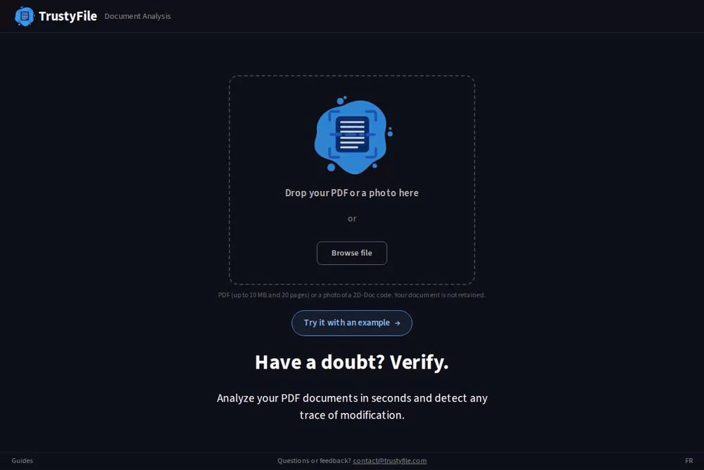

# TrustyFile

**Document Fraud Detection Tool** — Like VirusTotal, but for invoices and documents.

[](https://trustyfile.streamlit.app)
[](https://www.python.org/downloads/)
[](https://opensource.org/licenses/MIT)



## What is TrustyFile?

TrustyFile analyzes PDF documents (invoices, receipts, contracts) to detect signs of tampering or fraud. It runs **11 detection modules**, combines every finding into an evidence ledger (see [Scoring](#scoring-the-evidence-ledger) below), and returns a **trust score** from 0 to 100.

**Use cases:**
- Accounting teams verifying supplier invoices
- Banks checking loan documents
- Insurance companies analyzing claims
- Anyone who receives PDFs and wants to verify authenticity

## Detection Modules

| Module | What it checks |
|---|---|
| metadata | Producer/Creator/Author fingerprints, date sanity, repair marks |
| content | Dates, references, French company ids, IBAN checksums, anachronisms |
| visual | Converter/SPECIMEN watermarks (QR decode: next feature) |
| fonts | Font diversity, subset mixing, mid-line changes |
| images | Screenshots, resolution/compression, paste artifacts, EXIF dates/software |
| structure | Incremental updates, signatures (EU DSS), JavaScript, embedded files |
| overlay | Cover-and-retype boxes, conflicting text, cross-revision value changes |
| arithmetic | e-invoice XML vs visible totals & IBAN — CII (Factur-X) **and** UBL (Peppol) |
| forensics | Error-level analysis (ELA) of page renders |
| identity | MRZ check digits on ID documents (conditional) |
| twod_doc | French 2D-Doc barcodes vs visible text (needs libdmtx) |

**Bonus features:**
- **VirusTotal lookup** — Check file hash against malware databases (requires API key)
- **2D-DOC data panel** — View the decoded barcode fields (name, amount, dates) side by side with the document; the cross-check itself is scored by the `twod_doc` module above
- **Modification history** — View what changed between PDF revisions with content diffs
- **External verification (opt-in)** — SIRET/SIREN via INSEE, VAT via VIES; requires internet, off by default (`enable_external=True`)

## Quick Start

### Prerequisites

- Python 3.11+
- Tesseract OCR (for scanned documents)
- libdmtx (for 2D-Doc barcode scanning — French tax notices, payslips, etc.)

```bash
# Ubuntu/Debian
sudo apt install tesseract-ocr tesseract-ocr-fra libdmtx0b

# macOS
brew install tesseract libdmtx

# Windows
# Tesseract: https://github.com/UB-Mannheim/tesseract/wiki
# libdmtx: use WSL, or see https://github.com/dmtx/libdmtx
```

Streamlit Community Cloud installs system packages from `packages.txt`, which
already lists `tesseract-ocr`, `tesseract-ocr-fra`, and `libdmtx0b` — no extra
setup needed there.

### Installation

```bash
# Clone the repository
git clone https://github.com/edaubert42/trustyfile.git
cd trustyfile

# Create virtual environment
python -m venv venv
source venv/bin/activate  # Windows: venv\Scripts\activate

# Install dependencies
pip install -r requirements.txt
```

### Run the app

```bash
streamlit run app.py
```

Open http://localhost:8501 in your browser.

## Scoring: the evidence ledger

Every module emits flags; each flag becomes a piece of **evidence** —
`soft` or `hard`, pushing toward **tamper** or **genuine** — combined in
log-odds space (see `src/evidence.py`):

- **Soft evidence** (heuristics) is summed per module with diminishing
  returns: the strongest finding counts fully, the rest at half weight, so
  correlated symptoms of one edit don't stack linearly.
- **Genuine evidence** (a trusted signature, e-invoice XML that matches the
  page, a matching signed 2D-Doc) lifts the score — but is discarded
  whenever meaningful tamper evidence exists (anti-laundering guard):
  agreement proves nothing about a document already in question.
- **Hard evidence** is certainty, not heuristics: a hard tamper finding
  caps the score at 15; a hard genuine finding floors it at 85.

The score maps to bands: **GENUINE** (≥ 80), **REVIEW** (50–79),
**SUSPICIOUS** (< 50), or **UNVERIFIABLE** (unreadable input, or 3+
analysis modules crashed on the document).

## Example Output

```
invoice_2024_001.pdf

Trust Score: 62/100  MEDIUM RISK

[metadata] Score: 55
  [medium] Document processed by iLovePDF
  [medium] ModDate is 45 days after CreationDate

[content] Score: 85
  No issues detected

[fonts] Score: 70
  [low] 6 different fonts detected (typical: 2-4)

[images] Score: 40
  [high] Logo resolution (72dpi) doesn't match document (300dpi)
  [medium] EXIF creation date doesn't match document date
```

## Usage as Library

```python
from src.analyzer import TrustyFileAnalyzer

analyzer = TrustyFileAnalyzer()
result = analyzer.analyze("invoice.pdf")

print(f"Trust Score: {result.trust_score}/100")
print(f"Risk Level: {result.risk_level}")

for module_result in result.modules:
    print(f"\n[{module_result.module}] Score: {module_result.score}")
    for flag in module_result.flags:
        print(f"  [{flag.severity}] {flag.message}")
```

## Project Structure

```
trustyfile/
├── app.py                    # Streamlit interface
├── src/
│   ├── analyzer.py           # Main orchestrator (per-module crash isolation)
│   ├── evidence.py           # Evidence ledger — the scoring engine (log-odds)
│   ├── scoring.py            # Builds the ledger from module flags
│   ├── summary.py            # Rich EN/FR summary generation
│   ├── document_type.py      # Document-genre classifier (FP suppression)
│   ├── models.py             # Data structures (Flag, ModuleResult)
│   ├── i18n.py, translations/  # EN/FR summary theme strings
│   ├── modules/              # 11 detection modules (see table above)
│   │   ├── metadata.py
│   │   ├── content.py
│   │   ├── visual.py
│   │   ├── fonts.py
│   │   ├── images.py
│   │   ├── structure.py
│   │   ├── overlay.py        # cover-and-retype / cross-revision detector
│   │   ├── arithmetic.py     # e-invoice XML vs visible totals (CII + UBL)
│   │   ├── forensics.py      # ELA
│   │   ├── identity.py       # MRZ checksums
│   │   ├── twod_doc.py       # French 2D-Doc barcodes
│   │   └── external.py       # optional: SIREN/SIRET/VAT (opt-in, network)
│   └── extractors/           # PDF data extraction
│       ├── pdf_extractor.py
│       └── ocr.py
├── scripts/                  # Dev tools
│   ├── generate_demo_pdf.py  # Generate test PDF
│   ├── generate_tampered.py  # Generate tampered corpus samples
│   ├── build_corpus.py       # Corpus indexing for the band-gate tests
│   ├── eval_harness.py       # Calibration / evaluation harness
│   └── record_demo.py        # Record demo GIF
└── tests/                    # Unit tests
```

## Running Tests

```bash
# Run all tests
pytest tests/ -v

# With coverage report
pytest tests/ --cov=src --cov-report=html
```

## Roadmap

- [x] MVP with 5 core detection modules (metadata, content, visual, fonts, images)
- [x] Streamlit interface with dark theme
- [x] PDF structure analysis (incremental saves, modification history)
- [x] External verification (SIREN/SIRET via INSEE API, VAT validation)
- [x] Image forensics (ELA, editor detection)
- [x] VirusTotal hash lookup
- [x] 2D-DOC barcode scanning (French government documents)
- [x] Rich summary with verdict and bullet findings
- [ ] QR code scanning (pyzbar — verify QR URLs match document sender)
- [ ] Template matching (compare against known legitimate invoice layouts)
- [ ] API endpoint (FastAPI)
- [ ] Batch upload support
- [ ] Export analysis report as PDF
- [ ] Browser extension

## Disclaimer

TrustyFile provides a **risk assessment**, not a definitive fraud verdict. A low score doesn't prove a document is fake, and a high score doesn't guarantee authenticity. Always combine automated analysis with human judgment for important decisions.

## License

MIT License - see [LICENSE](LICENSE) for details.

## Contributing

Contributions are welcome! Please read [CONTRIBUTING.md](CONTRIBUTING.md) first.

---

Made with coffee by [Edouard Aubert](https://github.com/edaubert42)
