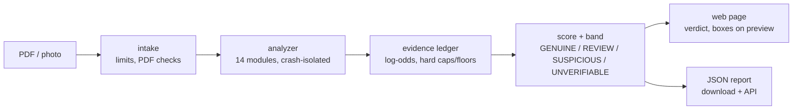

# TrustyFile

**Detects tampered invoices, payslips and official documents. Upload a PDF, get a trust score and the evidence behind it.**

**[▶ Try it live at trustyfile.com](https://www.trustyfile.com)**: no account needed, and one click runs the sample invoice.

[](https://github.com/edaubert42/trustyfile/actions/workflows/tests.yml)
[](https://www.python.org/downloads/)
[](https://fastapi.tiangolo.com/)
[](LICENSE)


*The sample invoice from the landing page ("Try it with an example", also at
[`/demo`](https://www.trustyfile.com/demo)). Its total was retyped over the original
in a later revision, and its VAT number is invalid. Regenerate the GIF with
`python scripts/record_demo.py`.*

## Why it exists

Invoice and document fraud is cheap to commit. A PDF editor is enough to change an
amount or an IBAN, and the result looks perfect on screen. TrustyFile reads what the
eye cannot see: the file's revision history, text hidden under a white box, font
subsets, producer fingerprints, checksums, and signed barcodes. It explains each
finding in plain English or French, and draws a box around the spot on the page.

## Engineering highlights

- **14 independent detection modules** feed one **evidence ledger** that combines
  findings in log-odds space. Correlated symptoms of a single edit do not stack.
  Any real tamper evidence discards the "looks genuine" evidence, so a forged
  document cannot buy its way to a good score.
- **Fails closed.** A document the analyzer cannot actually see (no text layer,
  crashed modules) is reported as UNVERIFIABLE instead of passing by default.
- **Cryptography, not only heuristics.** French 2D-Doc barcodes are verified
  with ECDSA against government certificates bundled offline. A valid signature
  is the only finding allowed to guarantee a high score.
- **Built for hostile input.** Every page render is clamped against crafted page
  geometry (`render_safety.py`). Embedded XML goes through `defusedxml`, which
  blocks XXE attacks. A broken PDF degrades to a partial result instead of crashing.
- **Measured on real documents.** 1,600+ pytest tests include false-positive
  regressions taken from real invoices and corpus band gates. CI runs the suite
  inside the production Docker image (Python 3.13), and again on Python 3.14.
- **Privacy by design.** Uploads are analysed on a temporary file and never
  written to permanent storage. Results live in a bounded in-memory store for
  15 minutes.
- **Shipped.** FastAPI with server-rendered Jinja pages, a JSON API, batch upload,
  and EN/FR. It runs on Railway behind Caddy, from the same Docker image CI tests.



## What is TrustyFile?

TrustyFile analyzes PDF documents (invoices, receipts, payslips, contracts) to detect signs of tampering or fraud. It runs **14 detection modules** (plus opt-in external verification), combines every finding into an evidence ledger (see [Scoring](#scoring-the-evidence-ledger) below), and returns a **trust score** from 0 to 100.

**Use cases:**
- Accounting teams verifying supplier invoices
- Landlords and banks checking payslips and tax notices
- Insurance companies analyzing claims
- Anyone who receives PDFs and wants to verify authenticity

## Detection Modules

| Module | What it checks |
|---|---|
| metadata | Producer/Creator fingerprints, date sanity, repair marks |
| content | Dates, references, French company ids, IBAN checksums, anachronisms |
| visual | Converter/SPECIMEN watermarks, QR codes (OpenCV): sender domain, URL shorteners, phishing TLDs |
| fonts | Font diversity, subset mixing, mid-line changes |
| images | Screenshots, resolution/compression, paste artifacts, EXIF dates/software |
| structure | Incremental updates, signatures (EU DSS), JavaScript, embedded files |
| overlay | Cover-and-retype boxes, conflicting text, cross-revision value changes |
| invisible | Text rendered invisibly or hidden behind covering elements |
| provenance | Producer structural fingerprints — catches a forged/stripped Producer string |
| arithmetic | e-invoice XML vs visible totals & IBAN — CII (Factur-X) **and** UBL (Peppol) |
| forensics | Error-level analysis (ELA) of page renders |
| identity | MRZ check digits on ID documents (conditional) |
| payslip | Net paid = net before tax − withholding tax, tax = base × rate, payment date vs pay period (conditional: payslips) |
| twod_doc | French 2D-Doc barcodes vs visible text, ECDSA signature checked offline against bundled certificates (needs libdmtx) |

**Bonus features:**
- **VirusTotal lookup** — Check file hash against malware databases (requires API key)
- **2D-DOC data panel** — View the decoded barcode fields (name, amount, dates) side by side with the document; the cross-check itself is scored by the `twod_doc` module above
- **Modification history** — View what changed between PDF revisions with content diffs
- **External verification** — SIRET/SIREN via INSEE, VAT via VIES; requires internet. On by default in the app (`make_analyzer` in `src/web/documents.py`); pass `enable_external=False` to the analyzer to run fully offline
- **JSON report** — Download the analysis as a versioned JSON file (`src/report.py`), or print the results page as a PDF
- **API** — `POST /api/v1/analyze` returns the same JSON report for a PDF (see [API](#api))
- **Batch upload** — drop up to 10 PDFs at once: a table with one verdict per document, each row opening the full results page, and one JSON report for the whole batch

## Quick Start

### Prerequisites

- Python 3.11+
- Tesseract OCR (for scanned documents)
- libdmtx (for 2D-Doc barcode scanning — French tax notices, payslips, etc.)

```bash
# Ubuntu/Debian
sudo apt install tesseract-ocr tesseract-ocr-fra libdmtx-dev

# macOS
brew install tesseract libdmtx

# Windows
# Tesseract: https://github.com/UB-Mannheim/tesseract/wiki
# libdmtx: use WSL, or see https://github.com/dmtx/libdmtx
```

### Docker (what production runs)

The `Dockerfile` is the one recipe for production and CI: Python 3.13 on
Debian 13, the system packages above, Caddy 2.11.9 in front of uvicorn
(`start.sh`). Railway builds its last stage (`railway.json`); CI runs the test
suite in its `test` stage, then boots the production image and smoke-tests it.

```bash
docker build -t trustyfile .                    # production image
docker run --rm -p 8080:8080 trustyfile         # http://localhost:8080
docker build --target test -t trustyfile:test . && docker run --rm trustyfile:test
```

`samples/` (real documents) is excluded from the build context by
`.dockerignore` and never enters an image.

### Installation

```bash
# Clone the repository
git clone https://github.com/edaubert42/trustyfile.git
cd trustyfile

# Create virtual environment
python -m venv venv
source venv/bin/activate  # Windows: venv\Scripts\activate

# Install dependencies (requirements-dev.txt adds the test-only libraries)
pip install -r requirements-dev.txt
```

### Run the app

```bash
uvicorn src.web.app:app --port 8000
```

Open http://localhost:8000 in your browser. The site is one FastAPI
application that renders its pages on the server (Jinja templates) and also
serves the API. Two optional keys are read from the environment:
`IBAN_API_KEY` (IBAN verification) and `VIRUSTOTAL_API_KEY` (file-hash lookup).

## Scoring: the evidence ledger

Every module emits flags; each flag becomes a piece of **evidence** —
`soft` or `hard`, pushing toward **tamper** or **genuine** — combined in
log-odds space (see `src/evidence.py`):

- **Soft evidence** (heuristics) is summed per module with diminishing
  returns: the strongest finding counts fully, the rest at half weight, so
  correlated symptoms of one edit don't stack linearly.
- **Genuine evidence** (a trusted signature, e-invoice XML that matches the
  page, a matching signed 2D-Doc) lifts the score — but is discarded
  whenever meaningful tamper evidence exists (anti-laundering guard):
  agreement proves nothing about a document already in question.
- **Hard evidence** is certainty, not heuristics: a hard tamper finding
  caps the score at 15; a hard genuine finding floors it at 85.

The score maps to bands: **GENUINE** (≥ 80), **REVIEW** (50–79),
**SUSPICIOUS** (< 50), or **UNVERIFIABLE** (unreadable input, or 3+
analysis modules crashed on the document).

## Example Output

The sample invoice (`public/static/demo/facture-exemple.pdf`), analysed
offline with the snippet below (modules without findings omitted):

```
Trust Score: 8/100  CRITICAL  (band: SUSPICIOUS)

[content] Score: 65
  [high] Invalid French VAT number: FR40732829320
  [low] IBAN fails checksum validation: FR7630006000011234567890180

[structure] Score: 55
  [medium] PDF has 1 incremental update(s)
  [high] Document was modified 2 days after creation

[overlay] Score: 50
  [critical] A value appears to have been covered and retyped on page 1: "1 200,00 EUR" was hidden and "2 200,00 EUR" placed over it (a change of +1,000.00).
```

The website runs with external verification on, so the same file scores 2
there.

## Usage as Library

```python
from src.analyzer import TrustyFileAnalyzer

analyzer = TrustyFileAnalyzer()
result = analyzer.analyze("invoice.pdf")

# trust_score is None when the band is UNVERIFIABLE
print(f"Trust Score: {result.trust_score}/100  {result.risk_level}  (band: {result.band})")

for module_result in result.modules:
    print(f"\n[{module_result.module}] Score: {module_result.score}")
    for flag in module_result.flags:
        print(f"  [{flag.severity}] {flag.message}")
```

## Project Structure

```
trustyfile/
├── Dockerfile, railway.json  # The image production and CI both run
├── Caddyfile, start.sh        # Deployment: Caddy in front of one uvicorn process
├── public/                   # Files served as they are: guides/, tools/ (generated),
│                             # static/ (icons, sample PDF), sitemap.xml, robots.txt
├── src/
│   ├── web/                  # The website
│   │   ├── app.py            # Pages: upload, results, batch (FastAPI)
│   │   ├── api.py            # JSON API (/api/v1/*), mounted in the app
│   │   ├── store.py          # In-memory results store (15 min, bounded)
│   │   ├── templates/, static/   # Jinja templates, stylesheet, script
│   │   └── views/            # Pure functions (data, lang) -> HTML
│   ├── site/                 # Generator of the guides and tools pages
│   ├── analyzer.py           # Main orchestrator (per-module crash isolation)
│   ├── intake.py, pipeline.py, batch.py  # Upload limits, shared temp file, batch items
│   ├── report.py             # Versioned JSON report (download + API)
│   ├── preview.py            # Page render + evidence boxes
│   ├── render_safety.py      # Render caps against hostile page geometry
│   ├── feedback.py           # Thumbs up/down storage + owner CSV export
│   ├── evidence.py           # Evidence ledger — the scoring engine (log-odds)
│   ├── scoring.py            # Builds the ledger from module flags
│   ├── summary.py            # Rich EN/FR summary generation
│   ├── document_type.py      # Document-genre classifier (FP suppression)
│   ├── models.py             # Data structures (Flag, ModuleResult)
│   ├── i18n.py, translations/  # EN/FR summary theme strings
│   ├── modules/              # 14 detection modules (see table above)
│   │   ├── metadata.py
│   │   ├── content.py
│   │   ├── visual.py
│   │   ├── fonts.py
│   │   ├── images.py
│   │   ├── structure.py
│   │   ├── overlay.py        # cover-and-retype / cross-revision detector
│   │   ├── invisible.py      # invisible / hidden text mismatch
│   │   ├── provenance.py     # producer structural fingerprints
│   │   ├── span_conflict.py  # shared span helper (overlay + invisible)
│   │   ├── arithmetic.py     # e-invoice XML vs visible totals (CII + UBL)
│   │   ├── payslip.py        # Payslip arithmetic (conditional: payslips only)
│   │   ├── forensics.py      # ELA
│   │   ├── identity.py       # MRZ checksums
│   │   ├── twod_doc.py       # French 2D-Doc barcodes
│   │   ├── twod_doc_crypto.py  # 2D-Doc ECDSA signature verification (offline)
│   │   └── external.py       # optional: SIREN/SIRET/VAT (opt-in, network)
│   └── extractors/           # PDF data extraction
│       ├── pdf_extractor.py
│       └── ocr.py
├── scripts/                  # Dev tools
│   ├── make_demo_invoice.py  # Build the sample invoice behind /demo
│   ├── generate_demo_pdf.py  # Older suspicious test PDF (iLovePDF, fonts, watermark)
│   ├── generate_tampered.py  # Generate tampered corpus samples
│   ├── build_corpus.py       # Corpus indexing for the band-gate tests
│   ├── eval_harness.py       # Calibration / evaluation harness
│   ├── run_analysis.py       # Analyse every PDF of a folder from the command line
│   └── record_demo.py        # Record docs/demo.gif from the sample invoice
└── tests/                    # Unit tests
```

## Running Tests

```bash
# Run all tests
pytest tests/ -v

# With coverage report
pytest tests/ --cov=src --cov-report=html
```

## API

The same analysis is available programmatically. One request, one PDF, one
JSON report — byte-identical to the "Download report (JSON)" file on the
results page, so scripts and readers share a single schema
(`schema_version` in the body, defined in `src/report.py`).

```bash
curl -F file=@invoice.pdf "https://www.trustyfile.com/api/v1/analyze?lang=fr"
```

| | |
|---|---|
| `lang` | `fr` (default) or `en` — language of the sentences and verdict |
| `external` | `true` (default, as in the web app) verifies SIRET/VAT against INSEE/VIES; `false` analyses the file alone, offline |
| Limits | PDF only, 10 MB, 20 pages — `415`, `413`, `422` otherwise, with a JSON `error` body |
| Load | 2 analyses at a time per server (`503` + `Retry-After` when busy), 20 requests/minute per client (`429`) |
| Docs | interactive OpenAPI at `/api/docs`, schema at `/api/openapi.json`, liveness at `/api/v1/health` |

Documents are analysed on a temporary file that is deleted when the answer is
sent; nothing is retained. Locally: `uvicorn src.web.app:app --port 8000`.

## Roadmap

- [x] MVP with 5 core detection modules (metadata, content, visual, fonts, images)
- [x] Web interface with dark theme (Streamlit at first, now FastAPI + Jinja)
- [x] PDF structure analysis (incremental saves, modification history)
- [x] External verification (SIREN/SIRET via INSEE API, VAT validation)
- [x] Image forensics (ELA, editor detection)
- [x] VirusTotal hash lookup
- [x] 2D-DOC barcode scanning (French government documents)
- [x] Rich summary with verdict and bullet findings
- [x] QR code scanning (OpenCV — QR URLs vs document sender)
- [x] 2D-Doc ECDSA signature verification (offline certificates)
- [ ] Template matching (compare against known legitimate invoice layouts)
- [x] API endpoint (FastAPI, `POST /api/v1/analyze`)
- [x] Batch upload — several PDFs at once, one row per document, batch JSON report
- [x] Export analysis report — print/save as PDF, JSON download
- [ ] Browser extension
- [ ] Paid access to the extra information (full details, report download) through a payment module such as Stripe — idea, not started; first measure how often the details are opened

## Disclaimer

TrustyFile provides a **risk assessment**, not a definitive fraud verdict. A low score doesn't prove a document is fake, and a high score doesn't guarantee authenticity. Always combine automated analysis with human judgment for important decisions.

## License

Proprietary — all rights reserved. See [LICENSE](LICENSE).

---

Made with coffee by [Edouard Aubert](https://github.com/edaubert42)
